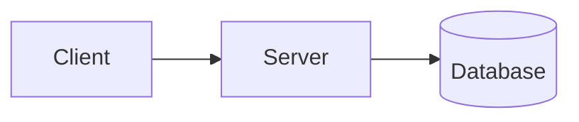

# Example Talk

Subtitle or one-line pitch

<div class="abs-bl m-6 text-sm opacity-60">
Conference Name · 2026
</div>

<div class="abs-br m-6">
  <QrCode :size="120" />
</div>

<!--
Speaker notes go in HTML comments at the end of a slide.
Press "p" in the browser for presenter mode.
-->

---
layout: center
---

# Who am I

- Filippo
- What I do
- Where to find me

---

# Agenda

1. The problem
2. The idea
3. Demo
4. Takeaways

---

# Code looks great

```ts {2|3-4|all}
function greet(name: string) {
  const greeting = `Hello, ${name}!`
  console.log(greeting)
  return greeting
}
```

Click to step through highlighted lines.

---
layout: two-cols
---

# Two columns

Left side text.

::right::

```bash
npm run dev -- my-talk
```

---

# Diagrams



---
layout: center
class: text-center
---

# Thank you!

Questions?

<QrCode class="mt-8" :size="220" />
